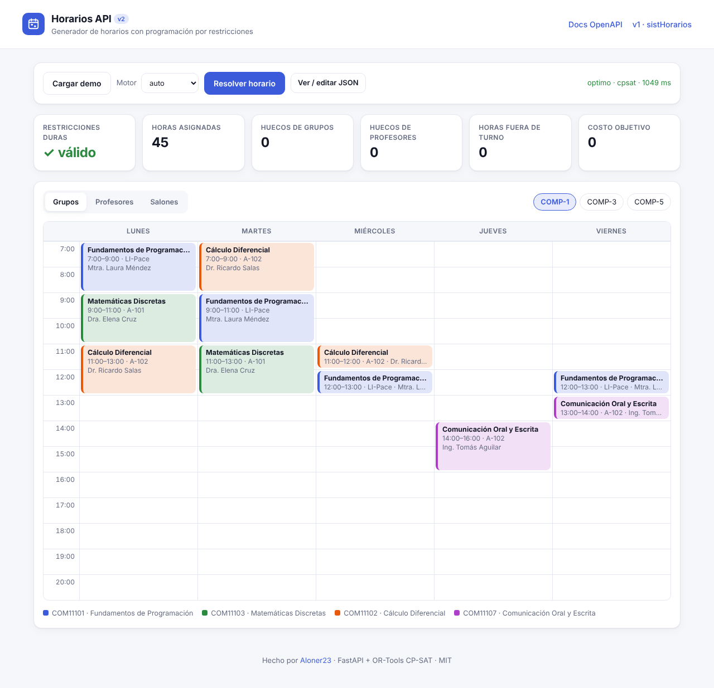
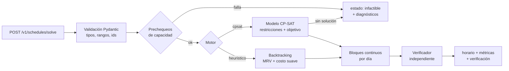

# Horarios API v2

**Versión 2 · API de optimización de horarios**

[Inicio rápido](#inicio-rápido) · [API](#api) · [Solucionador](#cómo-funciona-el-solucionador) · [Pruebas](#pruebas) · [Comparar con la versión Django](#de-sisthorarios-a-v2)

[](https://github.com/Aloner23/sistHorario/actions/workflows/ci.yml)

**Para evaluarlo:** inicia la aplicación localmente, abre `/docs`, consulta `GET /v1/examples/demo` y envía ese JSON a `POST /v1/schedules/solve`. Revisa el horario, los diagnósticos y `verificacion.valido`. También hay interfaz web en `/`.

**Generador de horarios escolares como servicio: API REST + solucionador por programación con restricciones (OR-Tools CP-SAT).**

Le das profesores, materias, salones, grupos y quién imparte qué; te devuelve un horario semanal que **nunca** empalma a un profesor, un salón o un grupo, respeta laboratorios vs. aulas y la disponibilidad de cada docente, y además **minimiza huecos** y respeta el **turno preferido** de cada profesor. Si no hay solución, te dice por qué.

> **English summary.** Horarios API v2 is a FastAPI service that builds weekly school timetables with Google OR-Tools CP-SAT. Hard constraints (no teacher/room/group double-booking, room type, teacher availability, weekly hours, contiguous daily blocks) are always satisfied; soft constraints (idle gaps, preferred shift) are minimized. Infeasible inputs return human-readable diagnostics. Includes a dependency-free web UI, OpenAPI docs, a backtracking fallback solver, 43 pytest tests, Docker and Vercel configs. It is the v2 rewrite of my earlier Django project [sistHorarios](https://github.com/Aloner23/sistHorarios).



---

## De sistHorarios a v2

Este proyecto es la **v2 de mi generador de horarios**. La v1, [sistHorarios](https://github.com/Aloner23/sistHorarios), era una app Django con MySQL donde se capturaban profesores, materias y salones, y un algoritmo voraz asignaba clases recorriendo bloques por preferencia (mañana/tarde/noche) y editando cadenas de texto como `"0-10,11-20,21-30,"` dentro de la tabla de salones.

| | v1 · sistHorarios (versión original, 2023) | v2 · Horarios API |
|---|---|---|
| Arquitectura | Django + plantillas HTML, acoplado a MySQL | API REST sin estado (FastAPI) + UI estática |
| Algoritmo | Voraz: asigna en orden, sin retroceso | CP-SAT: modelo de restricciones con objetivo; respaldo con backtracking |
| Garantías | Podía dejar materias sin asignar o con empalmes | Toda restricción dura se cumple, y un verificador independiente lo comprueba en cada respuesta |
| Infactibilidad | Error `UnboundLocalError` sin explicación | Diagnósticos con código y explicación |
| Datos | SQL construido con `format()` | Entrada validada con Pydantic v2 (tipos, rangos, referencias cruzadas) |
| Calidad | Sin pruebas | 43 pruebas, ruff, CI en GitHub Actions |

La tabla compara con el código original de 2023; la v1 también se modernizó después (pruebas, CI y reporte de clases sin asignar), pero sigue siendo un algoritmo voraz.

Se conserva el dominio original: claves de materia tipo `COM11101`, salones tipo `LI-Pace`, carrera + semestre, preferencia de turno y el tipo de salón (aula / laboratorio).

## Cómo funciona el solucionador



**1. Prechequeos** (`app/solver/diagnostics.py`). Condiciones necesarias baratas que explican la mayoría de los casos imposibles: materias sin salón compatible (tipo o capacidad), materias cuyas horas no caben con el máximo diario, profesores con más horas que disponibilidad, grupos con más horas que la semana y demanda total de laboratorios/aulas mayor que la oferta.

**2. Modelo CP-SAT** (`app/solver/cpsat.py`). Variables booleanas `x[tarea, día, hora]` (hay clase) y `z[tarea, salón, día, hora]` (en qué salón).

*Restricciones duras*
- Horas semanales exactas por materia y grupo.
- A lo más una clase por hora para cada **profesor**, cada **salón** y cada **grupo** (carrera + semestre).
- `z` solo existe para salones del tipo correcto (aula / laboratorio) y con capacidad suficiente.
- `x = 0` en franjas donde el profesor no está disponible.
- Por día, cada materia ocupa como máximo `max_horas_dia` horas en **un solo bloque continuo**.
- Opcional (por defecto activo): cada materia usa el mismo salón toda la semana.

*Objetivo (restricciones suaves)*

```
min  10·huecos_de_grupo + 3·huecos_de_profesor + 5·horas_fuera_del_turno_preferido
```

Un *hueco* es una hora libre entre dos clases del mismo día. Los pesos se pueden cambiar en `configuracion.pesos`.

**3. Motor heurístico** (`app/solver/heuristic.py`). Si OR-Tools no está instalado (o con `"motor": "heuristico"`), cada materia se parte en bloques diarios y se colocan con backtracking, eligiendo primero el bloque con menos opciones (MRV) y probando primero las opciones que crean menos huecos. Encuentra soluciones válidas rápido, pero no garantiza el óptimo ni puede demostrar que algo es infactible (en ese caso responde `sin_solucion`).

**4. Verificación** (`app/solver/validate.py`). La salida de cualquier motor pasa por un verificador escrito por separado que vuelve a revisar todas las restricciones duras. El resultado viaja en `verificacion` dentro de la respuesta.

## API

| Método | Ruta | Descripción |
|---|---|---|
| `POST` | `/v1/schedules/solve` | Genera un horario |
| `GET` | `/v1/examples/demo` | Entrada de ejemplo (3 grupos de Computación, 10 materias) |
| `GET` | `/health` | Estado y disponibilidad de CP-SAT |
| `GET` | `/docs` · `/redoc` | Documentación OpenAPI interactiva |
| `GET` | `/` | Interfaz web |

### Ejemplo

```bash
curl -X POST http://localhost:8000/v1/schedules/solve \
  -H "Content-Type: application/json" \
  -d '{
    "profesores": [
      {"id": "P1", "nombre": "Mtra. Laura Méndez", "turno_preferido": "matutino"},
      {"id": "P2", "nombre": "Ing. Sofía Ramírez"}
    ],
    "materias": [
      {"clave": "COM11101", "nombre": "Fundamentos de Programación", "horas_semanales": 4, "tipo": "laboratorio"},
      {"clave": "COM11102", "nombre": "Cálculo Diferencial", "horas_semanales": 3, "tipo": "aula"}
    ],
    "salones": [{"id": "A-101", "tipo": "aula"}, {"id": "LI-Pace", "tipo": "laboratorio"}],
    "grupos": [{"id": "COMP-1", "carrera": "Computación", "semestre": 1}],
    "asignaciones": [
      {"grupo": "COMP-1", "materia": "COM11101", "profesor": "P1"},
      {"grupo": "COMP-1", "materia": "COM11102", "profesor": "P2"}
    ],
    "configuracion": {"dias": ["lun", "mar", "mie"], "hora_inicio": 7, "hora_fin": 14}
  }'
```

Respuesta (recortada):

```json
{
  "estado": "optimo",
  "motor": "cpsat",
  "tiempo_ms": 26,
  "horario": [
    {"grupo": "COMP-1", "materia": "COM11101", "profesor": "P1", "salon": "LI-Pace", "dia": "lun", "inicio": 9, "fin": 11},
    {"grupo": "COMP-1", "materia": "COM11102", "profesor": "P2", "salon": "A-101", "dia": "lun", "inicio": 11, "fin": 12},
    {"grupo": "COMP-1", "materia": "COM11101", "profesor": "P1", "salon": "LI-Pace", "dia": "mar", "inicio": 9, "fin": 11},
    "..."
  ],
  "metricas": {
    "horas_asignadas": 7,
    "huecos_grupos": 0,
    "huecos_profesores": 0,
    "horas_fuera_de_turno": 0,
    "ocupacion_salones": 16.7,
    "objetivo": 0
  },
  "diagnosticos": [],
  "verificacion": {"valido": true, "violaciones": []}
}
```

Cuando no hay solución, la respuesta sigue siendo `200` con un diagnóstico:

```json
{
  "estado": "infactible",
  "horario": [],
  "diagnosticos": [
    {
      "codigo": "sin_salon_compatible",
      "mensaje": "La materia M1 (laboratorio) del grupo G1 no tiene ningún salón de tipo laboratorio.",
      "entidades": ["M1", "G1"]
    }
  ]
}
```

Los errores de forma (ids repetidos, referencias a materias inexistentes, rangos inválidos) devuelven `422`.

### Opciones de `configuracion`

| Campo | Default | Descripción |
|---|---|---|
| `dias` | `lun`–`vie` | Días hábiles |
| `hora_inicio` / `hora_fin` | `7` / `21` | Ventana diaria; `hora_fin` es la hora de salida |
| `mismo_salon_por_materia` | `true` | Fija un salón por materia y grupo |
| `motor` | `auto` | `auto`, `cpsat` o `heuristico` |
| `tiempo_limite_s` | `10` | Tiempo máximo del motor (máx. 60) |
| `pesos` | `10 / 3 / 5` | Pesos de huecos de grupo, huecos de profesor y horas fuera de turno |

Los turnos son `matutino` (7–13), `vespertino` (13–18) y `nocturno` (18–22).

## Inicio rápido

Requiere Python 3.12+.

```bash
python -m venv .venv && source .venv/bin/activate
pip install -r requirements-dev.txt
uvicorn app.main:app --reload
```

Abre <http://localhost:8000> para la interfaz y <http://localhost:8000/docs> para la documentación.

## Pruebas

```bash
pytest          # 43 pruebas
ruff check . && ruff format --check .
```

- **Solucionador** (`tests/test_solver.py`): el demo y 6 instancias aleatorias se resuelven con ambos motores y cada salida se revisa restricción por restricción con un chequeo independiente del verificador interno. También se prueba que CP-SAT no es peor que la heurística y que el verificador sí detecta soluciones alteradas.
- **Infactibilidad** (`tests/test_infeasible.py`): cada tipo de diagnóstico y un conflicto combinado que solo CP-SAT puede demostrar.
- **API** (`tests/test_api.py`): endpoints, validación `422`, frontend y esquema OpenAPI.

Si OR-Tools no está instalado, las pruebas exclusivas de CP-SAT se omiten y el resto corre con el motor heurístico.

La CI (`.github/workflows/ci.yml`) corre ruff y pytest en cada push a `main` y en cada pull request.

## Despliegue

**Docker**

```bash
docker build -t horarios-api .
docker run -p 8000:8000 horarios-api
```

**Estado de la demo alojada.** La evaluación está disponible mediante el inicio local o Docker. El enlace de Vercel anterior no corresponde a la aplicación actual; no se presenta como demo funcional hasta verificar `/`, `/health`, `/docs` y la generación de un horario.

**Vercel.** `vercel.json` envía todas las rutas a `api/index.py`, que expone la app ASGI. OR-Tools junto con sus dependencias (numpy, pandas) es pesado; si se supera el límite de tamaño de la función, se puede quitar `ortools` de `requirements.txt` y la API usará automáticamente el motor heurístico (`/health` reporta `"cpsat": false`). Para cargas reales conviene más un contenedor (Docker en Render, Fly.io, Cloud Run, etc.).

## Estructura

```
app/
  main.py            # FastAPI: rutas y archivos estáticos
  schemas.py         # Modelos Pydantic de entrada/salida
  demo.py            # Datos de ejemplo
  solver/
    __init__.py      # Orquestación: prechequeo -> motor -> verificación
    problem.py       # Representación interna compartida
    cpsat.py         # Motor CP-SAT
    heuristic.py     # Motor de respaldo (backtracking)
    diagnostics.py   # Explicaciones de infactibilidad
    validate.py      # Verificador independiente + métricas
  static/            # Interfaz web (HTML + CSS + JS, sin build)
api/index.py         # Entrada para Vercel
tests/               # pytest
```

## Roadmap

- [ ] Explicación mínima de infactibilidad con *assumptions* de CP-SAT (qué subconjunto de restricciones choca).
- [ ] Bloquear sesiones manualmente y re-optimizar el resto.
- [ ] Exportar a PDF, CSV e iCal por grupo / profesor / salón.
- [ ] Asignación automática de profesor según las materias que puede impartir (como `profesores_has_materias` en la v1).
- [ ] Persistencia opcional (SQLite / Postgres) y autenticación para varias escuelas.
- [ ] Franjas de media hora, como en la v1 (7:00, 7:30, …).

## Licencia

[MIT](LICENSE) © Carlos ([Aloner23](https://github.com/Aloner23))
